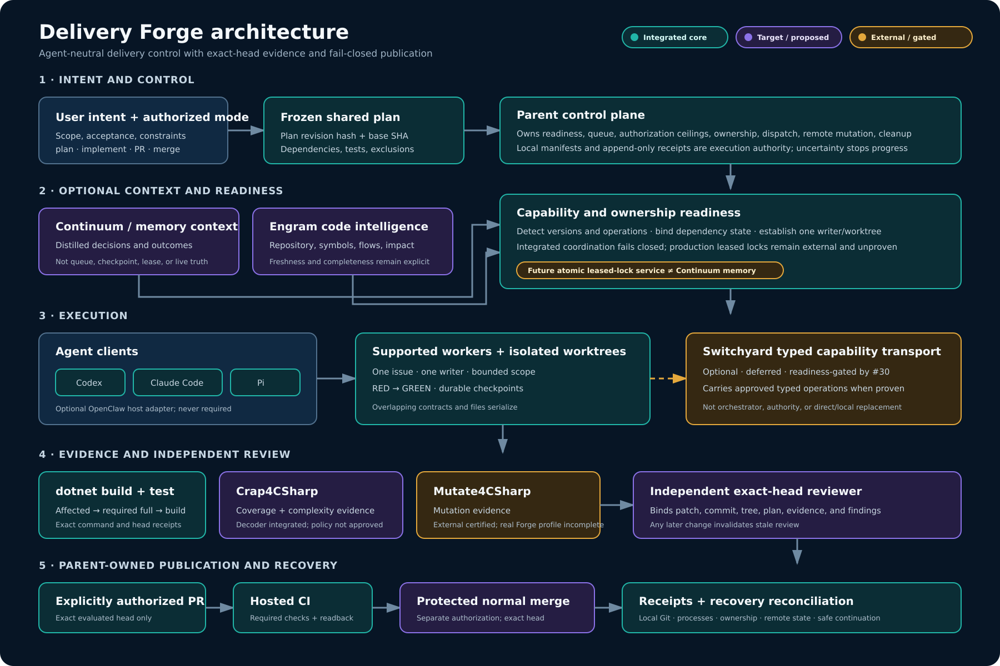
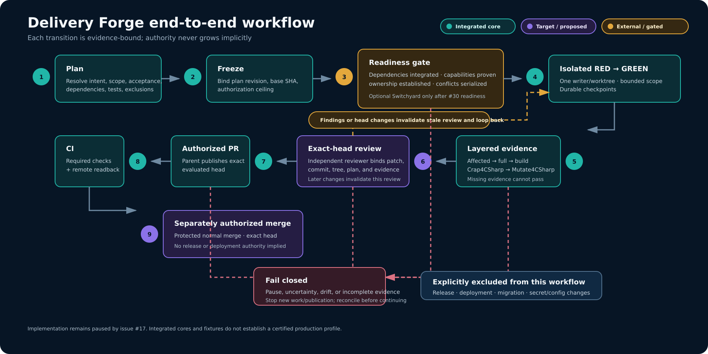

# Delivery Forge

**An evidence-driven harness for AI-assisted software delivery.**

Delivery Forge is an in-development portable harness that turns an approved software-delivery intent into a traceable plan, bounded execution, evidence-backed evaluation, independent review, and an explicitly authorized delivery action.

The target design packages a thin skill entry point with progressively loaded references, deterministic helpers where automation is justified, schemas, tests, and replaceable adapters. It does **not** rewrite its own runtime procedure, infer authorization from installed tools, or treat agent confidence as evidence.

## Status

**Implementation is paused.** As of 2026-10-13, `main` contains reviewed deterministic cores for contracts, planning, generic execution, fail-closed coordination, advisory evidence, review, local scheduling, fixture publication, and recovery/acceptance scenarios. The latest main CI is green on Ubuntu and Windows.

That is not a production-readiness claim. Production coordination is unavailable, quality enforcement lacks an approved policy/baseline, live reviewer and publication profiles are not certified, the full real end-to-end profile is incomplete, and `/delivery_forge` is not packaged or installed. [Issue #17](https://github.com/nucleoid/delivery-forge/issues/17) keeps all implementation paused until explicit owner resumption. See the maintained [issue and implementation status](docs/status.md) for evidence and blockers.

## Operating model

```text
understand -> resolve -> plan -> schedule -> implement
           -> evaluate -> review -> deliver -> remember
```

Delivery Forge separates five authorization modes:

- `plan`: investigate and produce a frozen implementation plan; no source change or publication.
- `implement`: execute an approved plan in an isolated writer workspace; no PR or merge authority is implied.
- `pr`: publish the exact evaluated head and open or update a pull request; no merge authority is implied.
- `merge`: merge only the exact reviewed head after required checks and branch protections pass.
- `resume`: reconcile durable local state, Git, live processes, and remote state before choosing a next action.

## Architecture and workflow

[](docs/diagrams/delivery-forge-architecture.svg)

The architecture separates the integrated repository core from target behavior and external/readiness-gated capability. Continuum supplies optional memory context, Engram supplies optional code intelligence, and neither replaces local execution authority or a future atomic leased-lock service. Switchyard is an optional typed capability transport—not an orchestrator or authority substitute—and remains deferred under [issue #30](https://github.com/nucleoid/delivery-forge/issues/30). [Open the editable architecture SVG.](docs/diagrams/delivery-forge-architecture.svg)

[](docs/diagrams/delivery-forge-workflow.svg)

The workflow makes review invalidation, fail-closed uncertainty, and separate PR/merge authority explicit. Release and deployment are excluded, and [issue #17](https://github.com/nucleoid/delivery-forge/issues/17) continues to pause implementation. [Open the editable workflow SVG.](docs/diagrams/delivery-forge-workflow.svg)

The normal intake is a minimal interview. Delivery Forge asks one plain conversational question—with a recommendation—only when a genuine intent, risk, or product decision belongs to the user. Engineering questions are resolved from repository evidence when possible. A deep interview is available by explicit opt-in.

## Core principles

- A shared plan artifact records scope, acceptance criteria, source of each decision, exact files/symbols/contracts, prerequisites, test policy, rollout/rollback, unknowns, and exclusions.
- Execution freezes a plan revision hash and base SHA. Drift requires reconciliation, not wishful thinking.
- One writer/worktree owns an issue. Shared contracts, overlapping files, and migrations serialize.
- A parent orchestrator owns the queue, leases, administrative actions, remote publication, and cleanup.
- Opened pull requests are not treated as integrated dependencies.
- Local manifests and receipts are execution authority. Memory stores distilled decisions and outcomes, not raw logs.
- Unsupported tools, timeouts, missing coverage, and incomplete mutation enumeration cannot become a pass.
- PR, CI, merge, release, and deployment are distinct states and authorizations.

## Target package shape

```text
delivery-forge/
├── SKILL.md
├── references/
│   ├── planning.md
│   ├── orchestration.md
│   ├── worker-contract.md
│   ├── quality-gates.md
│   ├── memory-code-intelligence.md
│   └── recovery-publication.md
├── schemas/
├── scripts/          # deterministic helpers only when justified
├── adapters/
└── tests/
```

The repository currently implements component libraries under `components/`; the root skill, helper CLI, installation flow, and package-owned uninstall proof remain [issue #12](https://github.com/nucleoid/delivery-forge/issues/12) work and do not exist yet.

## Documents

- [Architecture](docs/architecture.md)
- [Operative coding-agent architecture](docs/operative-agent-architecture.md)
- [Plan and execution contracts](docs/plan-contract.md)
- [Quality gates and evidence receipts](docs/quality-gates.md)
- [Recovery and publication](docs/recovery-publication.md)
- [Roadmap](docs/roadmap.md)
- [Issue and implementation status](docs/status.md)

## Integration boundary

The design can integrate with a scoped memory system, code intelligence, an atomic leased-lock service, Git hosting, and language-specific evidence tools. Codex, Claude Code, and Pi are generic product targets; OpenClaw is optional. Every adapter must detect actual capabilities. An installed CLI, fixture, merged parser, or planning document is not proof that every command, output shape, or production guarantee is available. Optional Switchyard integration is deferred and readiness-gated in [issue #30](https://github.com/nucleoid/delivery-forge/issues/30).

## Non-goals

Delivery Forge does not modify or fork an agent runtime, permit runtime self-rewriting, make external side effects transactional, let workers weaken policy, or equate labels/checkpoints/open PRs/partial tests with ownership or completion. It never expands a delivery mode into merge, deployment, migration, reauthentication, backfill, or secret changes without distinct authorization.

## License

MIT. See [LICENSE](LICENSE).
